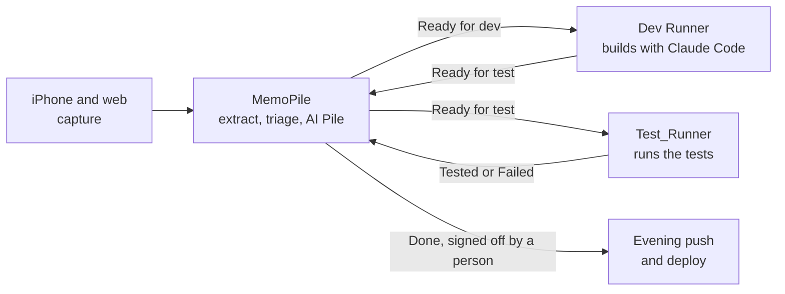
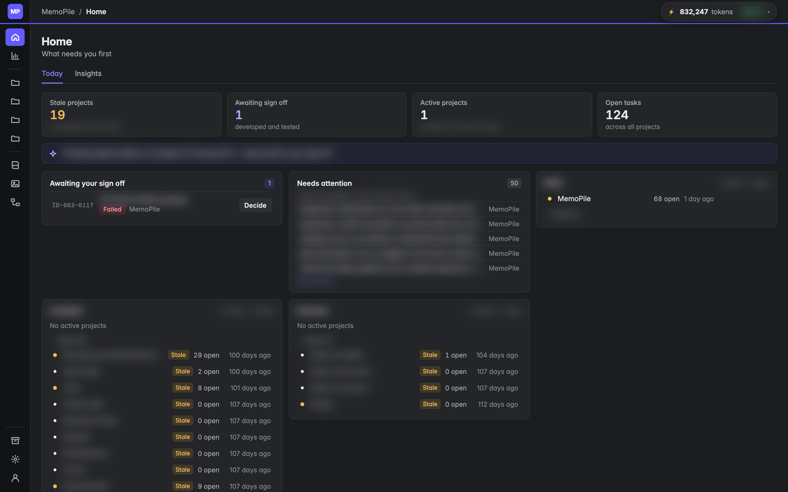
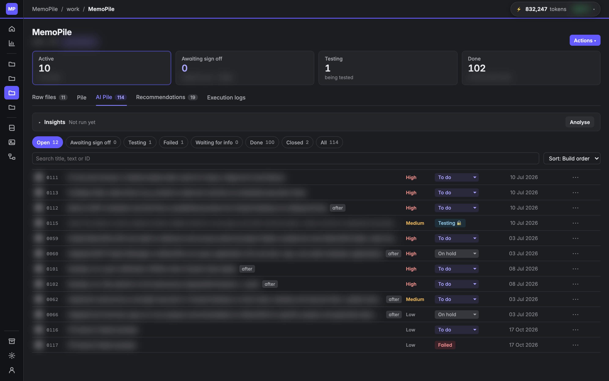
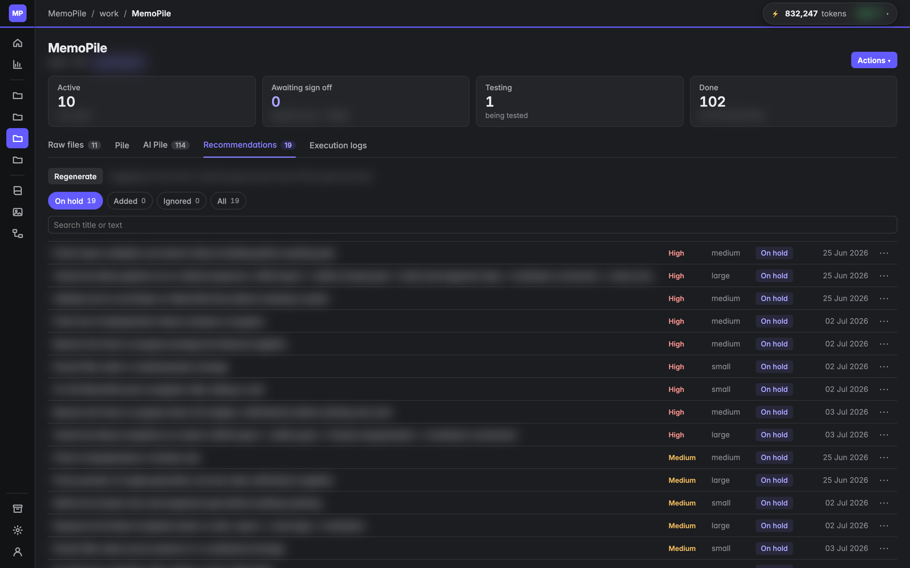
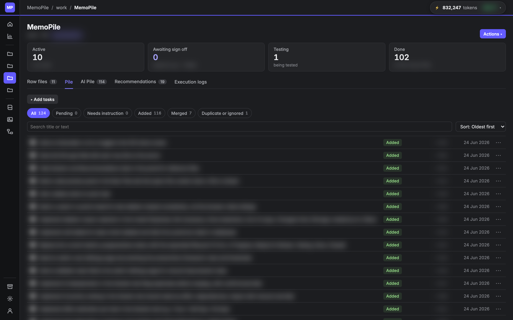
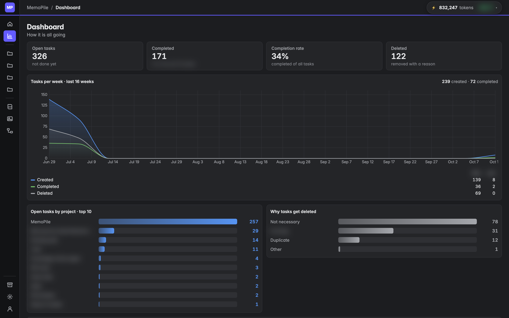

# MemoPile

> Part of a larger agent platform. ▶ [Watch the 90-second overview](https://github.com/man-pi)

An AI task pile. Notes captured on the iPhone or the web become tasks; Claude extracts, triages and prioritises them; and an agent pipeline builds and tests the work, with a person signing off every release.

> **Source code is private.** This repository shows what MemoPile does and how it is built. The code is available on request.

## What it does

1. **Capture.** Share any note or Markdown file from the iPhone (share extension), add a quick task by voice or text, or upload files in the web app.
2. **Extract.** Claude reads each note and pulls out tasks. The original stays untouched as a raw file.
3. **Triage.** New tasks are compared with what is already there: added, merged, marked duplicate, ignored, or flagged as needing an instruction. Nothing is deleted.
4. **Curate.** The **AI Pile** is the working board, with priority, effort, due dates, comments and a full lifecycle. **Recommendations** suggest what to do next; only approved ones become work.
5. **Build and test.** Projects flagged "App to develop" are linked to an app in Project Manager, and their tasks flow through the agent pipeline below.

## The pipeline

MemoPile never calls the laptop: the runners call MemoPile, each with its own scoped token.

## Screenshots

Real screens from daily use; task text, project and category names are blurred.

| | |
|---|---|
|  |  |
| **Home**: what needs attention first | **AI Pile**: the working board, with priority, status and build order |
|  |  |
| **Recommendations**: AI next-step advice, approved before it becomes work | **Pile**: raw extracted tasks and how each was triaged |
|  | |
| **Dashboard**: open, completed and deleted tasks across all projects | |

## How it is built

| Part | Technology |
|---|---|
| Web app | React and Vite frontend, Express API, live updates over server-sent events |
| Data | PostgreSQL, about 20 tables: projects, raw files, tasks, links, comments, events, tests, knowledge base, AI usage |
| iOS | SwiftUI app with a share extension, quick capture with voice, and push notifications |
| AI | Claude for task extraction, triage, merging, prioritisation and recommendations, with token usage tracked per call |
| Hosting | Railway, deployed automatically from the main branch |
| Backups | Daily database snapshots and a daily zip, kept locally |
| Agent access | An MCP server, so AI assistants can work on the project directly |

## Part of a pipeline

MemoPile is the task source for a small set of tools that work together:

- [**Dev Runner**](https://github.com/man-pi/dev-runner-showcase): builds tasks with Claude Code and writes their tests
- [**Test_Runner**](https://github.com/man-pi/test-runner-showcase): runs Playwright, Cypress, Jest and k6, and reports back
- [**Project Manager**](https://github.com/man-pi/project-manager-showcase): knows every app's folder and ports, and starts apps
- [**Mission Control**](https://github.com/man-pi/mission-control-showcase): shows all of them side by side

## Licence

Copyright (c) 2026 man-pi. All rights reserved. The screenshots and text in this repository may not be reused without permission.
